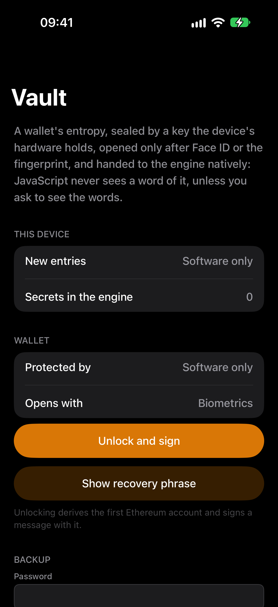
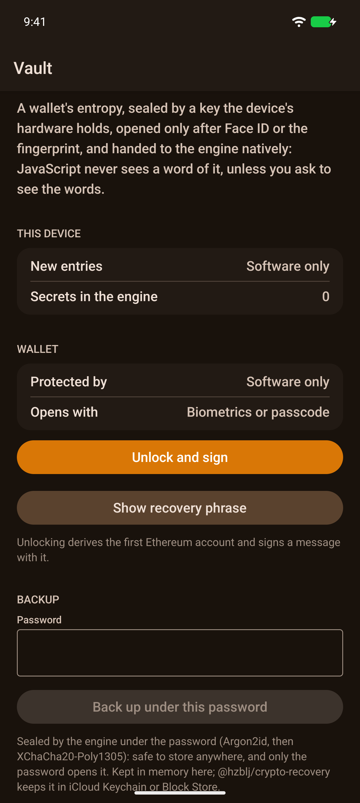

# crypto-vault

[](https://www.npmjs.com/package/@hzblj/crypto-vault)
[](./LICENSE)

A wallet kept by the phone's security hardware, for React Native and Expo. Its BIP-39 entropy is sealed under a key
the Secure Enclave or StrongBox holds, opened only after Face ID or the fingerprint, and handed to the
[`@hzblj/nitro-crypto`](https://github.com/hzblj/nitro-crypto) engine natively: JavaScript gets a wallet that signs, and
never a word or byte of what is behind it.

<p>
  
  
</p>

```sh
npx expo install @hzblj/crypto-vault @hzblj/nitro-crypto react-native-nitro-modules
```

```ts
import {ethereumAdapter} from '@hzblj/crypto-ethereum'
import {createVault} from '@hzblj/crypto-vault'
import {createCryptoEngine} from '@hzblj/nitro-crypto'

const crypto = createCryptoEngine({adapters: [ethereumAdapter()]})
const vault = createVault(crypto)

await vault.create('main') // fresh entropy, sealed natively before anything else sees it
vault.protection('main') // 'secure-enclave' on an iPhone, 'strongbox' or 'tee' on Android

const wallet = await vault.unlock('main', {prompt: 'Unlock your wallet'}) // Face ID, then a wallet in the engine
const account = await wallet.deriveAccount({chain: 'ethereum', index: 0})
await account.signMessage({message: 'Hello from the vault'})
wallet.dispose()

await vault.unlock('main', {passphrase, prompt: 'Unlock your wallet'}) // a BIP-39 passphrase, applied natively

const words = await vault.revealMnemonic('main', {prompt: 'Show your recovery phrase'}) // the one secret that comes out

const backup = await vault.backup('main', {password, prompt: 'Back up your wallet'}) // sealed by the engine, safe anywhere
await vault.restore('main', backup, {password}) // on another device, straight into its hardware

// Or under a passkey's PRF output, with nothing to remember (createVault(crypto, {relyingParty: 'example.com'}))
const sealed = await vault.backup('main', {passkey: {name: 'Main wallet'}, prompt: 'Back up your wallet'})
await vault.restore('main', sealed, {passkey: true})
```

**[Documentation](./packages/crypto-vault/README.md)**: install, the API, what protects an entry on each platform, a
BIP-39 passphrase, moving a wallet to another device under a password or a passkey (and the app setup a passkey needs),
and what is not in this version.

| | iOS | Android |
| --- | --- | --- |
| Key | P-256 in the Secure Enclave | AES-256-GCM in StrongBox, or the trusted environment |
| Sealing | ECIES to the key's public half | AES-GCM, one BiometricPrompt |
| Opens with | Face ID or Touch ID, or the passcode too | Strong biometrics, or the device credential too (a time-bound key before API 30) |
| New biometrics | The key is deleted: the entry is lost | The key is invalidated: the entry is lost |
| Stored | Keychain, this device only, with a passcode | The no-backup directory |

## This repository

| Path | What lives there |
| --- | --- |
| `packages/crypto-vault/` | `@hzblj/crypto-vault`: the spec, the C++ binding, the Swift and Kotlin platform halves, the facade |
| `apps/example/` | The example: create or restore a wallet, see what protects it, unlock and sign (under a passphrase too), show its words, back it up under a password or a passkey and restore it, remove it |
| `scripts/` | The pack check, version sync |
| `docs/` | [Decisions](./docs/adr) |

```sh
yarn                 # install
yarn test            # the facade's tests, on nitro-crypto's engine compiled to WebAssembly
yarn typecheck       # tsc
yarn lint            # Biome
yarn pack:check      # what npm receives, and a consumer type-check
yarn ios             # the example on the iOS simulator (yarn android for Android)
```

[Security](./SECURITY.md) · [MIT](./LICENSE)
